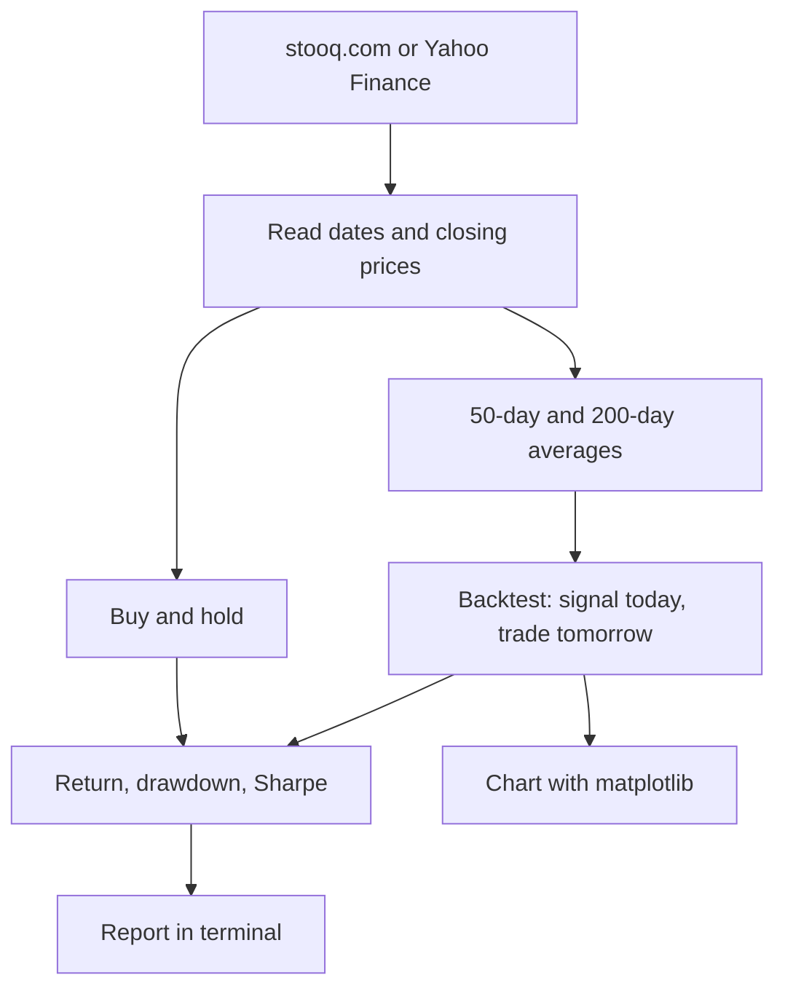

# Gold Price Strategy Analyzer

A Python program that tests a well-known trading rule on real gold prices and checks whether it would have done better than just buying gold and holding it.

The rule is the "golden cross": **buy** when the 50-day average price goes above the 200-day average, and **sell** when it goes back below.

> For learning only, not financial advice.

## Why I made it

During my internship at KG Infotech, I worked on gold trading bots, so I wanted to see for myself whether a simple, famous trading rule actually works on gold.

## What it does

- Downloads daily gold prices. It tries stooq.com first, and if that fails, it uses Yahoo Finance (`GC=F`, gold futures).
- Starts with $10,000, follows the buy/sell rule, and charges a 0.1% fee on every trade
- Compares the result with buying once and holding
- Prints total return, yearly return, the worst drop (max drawdown), and the Sharpe ratio, which measures return compared with risk
- Saves a chart of the prices with buy/sell points, the value of $10,000 over time, and the drops
- `--sweep` tries 20 different average lengths and ranks them


*Gold, 2015–2026. Green ▲ = buy, red ▼ = sell.*

## How it works



- The program decides to buy or sell at today's closing price, but makes the trade at **tomorrow's** price. In real life you only know today's close after the market closes.
- The moving averages use a running sum, so each new day only needs one add and one subtract.

**Tools:** Python, matplotlib, yfinance, Terminal, GitHub

## Results

Gold from Jan 2, 2015 to Nov 13, 2026 (2,985 trading days), starting with $10,000:

| | Golden cross (50/200) | Buy & hold |
|---|---|---|
| Final value | $23,081 | $32,735 |
| Total return | 130.8% | 227.7% |
| Yearly return | 7.3% | 10.5% |
| Worst drop | -27.5% | -26.9% |
| Sharpe ratio | 0.56 | 0.68 |

The strategy made 8 trades: 4 won and 4 lost. The best trade was +102.0% and the worst was -6.9%.

**What this shows:** the golden cross made money, but less than just holding gold. It also didn't avoid the worst drop. Most of its profit came from one big trade.


*The report printed in my terminal.*

## Timeline

November 2026:

1. **Picked the idea:** test a famous trading rule on gold, since I worked on gold trading bots during my internship
2. **Wrote the code** with help from an AI coding assistant
3. **Set up Python on my Mac** with a virtual environment and installed matplotlib and yfinance
4. **Ran it.** stooq.com gave a 404 error, so it switched to Yahoo Finance and got 2,985 days of gold prices
5. **Looked at the results:** the golden cross made less than buy & hold
6. **Uploaded the code, screenshots and this README** to GitHub

## How I built it

I made this in November 2026 for my portfolio assignment, with help from an AI coding assistant. I ran it on my own Mac, got the results above, and uploaded it here.

## Problems I ran into

- **stooq.com returned `HTTP Error 404`** when I ran it. The program switched to Yahoo Finance on its own, and that worked.
- **`pip3 install` was blocked** with an `externally-managed-environment` error, because my Python comes from Homebrew. I made a virtual environment and installed matplotlib and yfinance there.

## How to run it

```bash
git clone https://github.com/ashah374/gold-strategy-analyzer.git
cd gold-strategy-analyzer
python3 -m venv venv
source venv/bin/activate
pip install matplotlib yfinance
python3 analyzer.py
python3 analyzer.py --sweep
```

