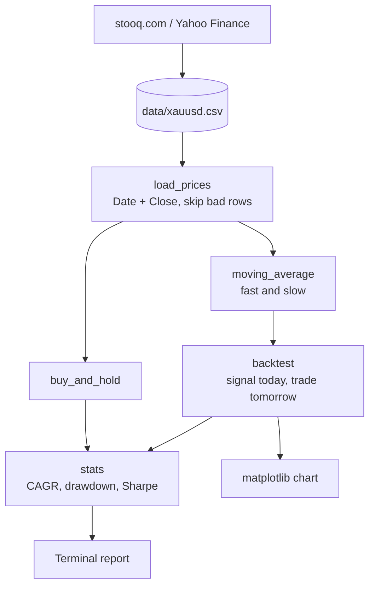

# 📈 Gold Price Strategy Analyzer

A Python tool that downloads real daily gold prices (XAU/USD), **backtests** a moving-average crossover trading strategy on them, compares it with simply buying and holding gold, and charts the result. It can also test 20 strategy settings at once and rank them.

> Educational project, not financial advice.

## 1. Overview
During my internship I worked around automated trading systems, and I kept wondering: *do the simple rules traders talk about actually work?* One of the most famous is the **"golden cross"**: buy when the 50-day average price crosses above the 200-day average, and sell when it crosses back below. This project tests that rule honestly on real data.

**Features**
- ⬇️ Downloads daily prices from **stooq.com** (free, no API key), with **Yahoo Finance** as a backup, and saves them in `data/`
- 🔁 Backtests any fast/slow moving-average pair, including a **0.1% fee per trade**
- 📊 Reports **total return, yearly return (CAGR), max drawdown, Sharpe ratio, number of trades and win rate**, side by side with buy & hold
- 🖼️ Draws a 3-panel chart: price with buy/sell markers, value of $10,000 over time, and drawdown
- 🔬 `--sweep` tests 20 combinations and ranks them by Sharpe ratio
- 🌍 Works with any symbol, e.g. `--symbol xagusd` (silver) or `--symbol aapl.us`


*Gold 2015–2026 with the 50/200-day crossover. Green ▲ = buy, red ▼ = sell.*

## 2. How It Works


1. **Moving averages:** `moving_average()` keeps a running sum, so each day costs one add and one subtract instead of re-adding the whole window.
2. **Signals:** a *buy* is when yesterday fast ≤ slow and today fast > slow. A *sell* is the opposite.
3. **Backtest:** starts with $10,000. It is either fully in gold or fully in cash, and every trade pays a fee.
4. **Metrics:**
   - **CAGR:** the average yearly growth rate
   - **Max drawdown:** the worst fall from a peak, i.e. how painful it was to hold
   - **Sharpe ratio:** average daily return ÷ how much returns swing, scaled to a year. Higher means more return for the risk.

**Tools:** Python 3, matplotlib, urllib, csv, math, argparse, Git & GitHub, VS Code


*The terminal report comparing the strategy with buy & hold.*

## 3. Results
<!-- Fill these in from YOUR run of: python3 analyzer.py -->
| Gold, 2015–today | Crossover 50/200 | Buy & hold |
|---|---|---|
| Final value of $10,000 | $_____ | $_____ |
| Yearly return (CAGR) | ___% | ___% |
| Worst drop (max drawdown) | ___% | ___% |
| Sharpe ratio | ___ | ___ |

**What I found:** _(1–2 sentences in your own words, for example: did the crossover beat buy & hold? Did it at least avoid the big drops? What did `--sweep` show?)_

## 4. Timeline
| Phase | What I did |
|---|---|
| 1. Research | Learned how moving-average crossovers work and which metrics professionals use |
| 2. Data | Wrote the downloader, cache and CSV loader |
| 3. Backtest | Built the strategy loop, fees and buy & hold comparison |
| 4. Metrics & charts | Added CAGR, drawdown and Sharpe, then the 3-panel chart |
| 5. Sweep & docs | Added `--sweep`, tested other symbols, recorded the demo and wrote this README |

## 5. Challenges & Bugs Fixed
- **Look-ahead bias.** My first version bought at the *same* closing price that created the signal, but you only know the close once the day is over. Now the signal is decided at today's close and the trade happens at **tomorrow's** close, which made the results more honest (and a bit worse).
- **Ignoring trading costs** made the strategy look better than it is, especially for fast settings that trade a lot. I added a 0.1% fee to every buy and sell.
- **Slow moving averages.** Recalculating a 200-day average from scratch every day repeats a lot of work. A running sum makes each day O(1).
- **Overfitting.** The best row in `--sweep` is only the best on *past* data. The tool prints a warning, because picking the past winner doesn't mean it will win next.
- **Unreliable downloads.** If one data source fails, the tool tries a second one, and you can always pass your own file with `--file`.

## ▶️ Run It Yourself
```bash
git clone https://github.com/ashah374/gold-strategy-analyzer.git
cd gold-strategy-analyzer
pip3 install -r requirements.txt
python3 analyzer.py                       # gold, 50/200-day, since 2015
python3 analyzer.py --fast 20 --slow 100  # try other settings
python3 analyzer.py --sweep               # rank 20 combinations
```
